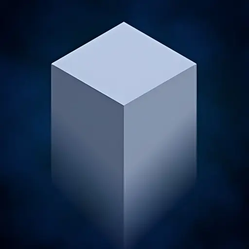
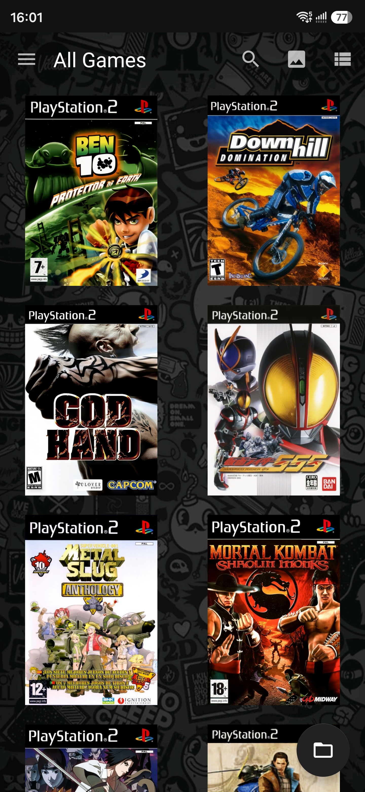
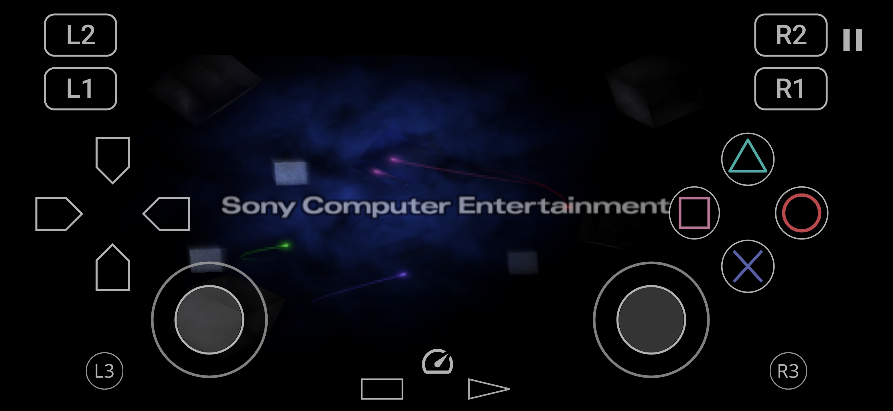
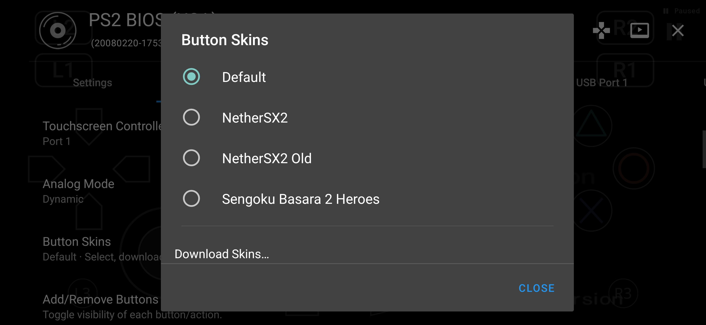
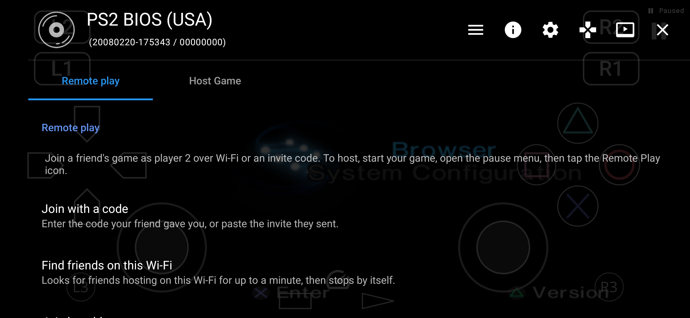

  

<h1 align="center">PSX2</h1>

  <strong>Classic Interface. Modern Emulation Core.</strong>

  An unofficial Android PlayStation 2 emulator project combining
  the familiar AetherSX2 interface with the ARMSX2 emulation core.

  
  
  
  

---

## About

Previously named **ARMSX2 Hybrid**. The public project name is now **PSX2**; the existing GitHub repository URL is retained.

Android application ID: `com.psx2.glitch`. This is a separate Android app from `com.armsx2.hybrid`, not an in-place update. No automatic access to old app data or SAF grants is assumed. See [data migration plan](docs/DATA-MIGRATION.md).

**PSX2** is an unofficial Android PlayStation 2 emulator project that combines the classic AetherSX2/NetherSX2-based frontend with the ARMSX2 emulation core.

The project focuses on preserving the familiar AetherSX2 user experience while introducing newer emulation technology, improved touchscreen controls, additional customization options, and modern features.

PSX2 is independently developed and is not an official release of ARMSX2, AetherSX2, NetherSX2, or PCSX2.

---

## Features

### ARMSX2 Emulation Core

- Powered by the ARMSX2 2.9.1 emulation core.
- Classic AetherSX2/NetherSX2-based interface.
- Graphics and emulator settings compatibility integration.
- Hardware and software rendering options, subject to core support.
- Performance and compatibility improvements inherited from the integrated core.

### Advanced Touchscreen Controls

- **Dynamic Analog:** Floating analog sticks that adapt to touch position.
- **Static Analog:** Traditional fixed-position analog sticks.
- **Custom Button Skins:** Customizable touchscreen button appearance.
- Adjustable touchscreen layouts.
- Controller layout and added/removed buttons are prepared before the VM starts; reused layouts also refresh visibility.
- Enabled per-game controller configuration acknowledgement shares the core OSD queue with patch messages, including a controller icon.
- Multitouch input support.

### Enhanced Game Library

- Automatic game cover downloads.
- 2D and 3D game cover display modes.
- Familiar game library navigation.
- Library-only Background Gallery: Default (Follow App Theme), Classic Plasma, and Custom Image.
- Classic Plasma uses broad, soft procedural blue shading with a 30 FPS target and foreground-only animation.
- Custom Image opens the picker when no image exists, reuses the selected image across preset switches, and offers Choose Image for replacement; Apply saves the choice.

### Remote Play

- Remote Play integration.
- Designed to extend gameplay across connected devices.
- Experimental functionality undergoing testing and development.

### In-Game Features

- In-game quick menu.
- Save State and Load State menu integration.
- Frame limiter controls.
- Software renderer toggle.
- Customizable touchscreen controls.

Some emulator settings and features may still require additional compatibility work.

---

## Screenshots

### Game Library

  

### Gameplay

  

### Custom Button Skins

  

### Remote Play

  

---

## Development Status

**Current Version:** 1.0.0-beta

The current private Android build is **15284**, named **PSX2**, with application ID `com.psx2.glitch`. It has been installed separately on the owner's device. Build/host validation passes; this publication update does not establish full device UI or gameplay acceptance. The public repository remains a partial source preview, with no APK download. See [build status](docs/BUILD-STATUS.md).

PSX2 is currently under active development.

### Development Priorities

- Improving emulator settings compatibility.
- Refining touchscreen controls and customization.
- Expanding custom button skin support.
- Testing Remote Play stability and performance.
- Improving game compatibility and stability.
- Preparing for future public releases.

Performance and compatibility may vary depending on the game, device, and emulator configuration.

---

## Downloads

**Public APK downloads are not available at this time.**

Release information will be published once the application is ready for distribution and the applicable licensing requirements have been addressed.

---

## Source Code

This repository contains selected source code, integration components, tests, and documentation from the PSX2 project.

The published source is a partial source preview and does not represent the complete buildable source code of the combined application. It is not complete GPL Corresponding Source for the hybrid APK.

Some legacy components are excluded due to unresolved licensing and redistribution requirements.

See [Publication Audit](PUBLICATION-AUDIT.md) for more information.

---

## Credits & Acknowledgements

PSX2 builds upon the work of several emulator projects:

- **[PCSX2](https://github.com/PCSX2/pcsx2)** — PlayStation 2 emulation technology.
- **[ARMSX2](https://github.com/ARMSX2/ARMSX2)** — ARMSX2 emulation core.
- **AetherSX2** — Original Android emulator foundation and interface.
- **[NetherSX2](https://github.com/Trixarian/NetherSX2-patch)** — Modifications and improvements to AetherSX2.

Special thanks to the developers and contributors of these projects.

---

## Legal & Licensing

PSX2 is an independent, unofficial community project.

This project is not affiliated with, sponsored by, or endorsed by Sony Interactive Entertainment, PCSX2, ARMSX2, AetherSX2, or NetherSX2.

The ARMSX2 core is subject to the GNU General Public License. Other components may have separate licensing and redistribution restrictions.

The licensing requirements of the combined application are being reviewed before any public binary release.

No copyrighted game files, BIOS images, or console firmware are provided.

PlayStation and PlayStation 2 are trademarks of Sony Interactive Entertainment.

---

  <strong>Made for the PS2 Emulation Community</strong>

  <em>Classic experience. Modern core. More possibilities.</em>

